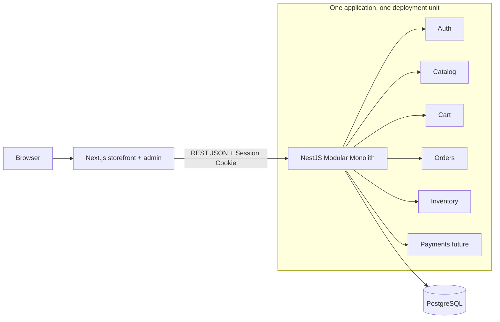

# System Architecture (v1.0)

## 1. Topology


- `bookstore-frontend`: riêng repo, routing UI, SSR/RSC, API client, form handling, không truy cập DB trực tiếp.
- `bookstore-backend`: riêng repo, NestJS modules/DI, validate, rules, transaction, data access.
- PostgreSQL: 1 DB, quyền truy cập chỉ từ backend.
- Local Docker Compose: nằm backend repo, build cả 2 repo nếu cùng cấp.

## 2. Backend module ownership
| Module | Owns | Public contract |
|---|---|---|
| Auth | users, sessions, permissions | register/login/me/logout |
| Wishlist | customer saved books | list/add/remove wishlist items |
| Catalog | books, authors, categories, book images | public list/detail; ADMIN book/category management; soft archive via status |
| Cart | cart/cartItems | manage cart lines |
| Orders | orders/orderItems/address snapshots/status events | checkout/history; ADMIN state transitions with actor audit |
| Inventory | book.stock, movements | atomic reserve/sale/restore, admin adjust |
| Payments | payment attempts | COD MVP; provider future |
| Banners | homepage banner records | active public carousel feed; ADMIN create/edit/activate/reorder by validated image URL |
| AdminReporting | derived stats + customer-safe directory | authenticated `ADMIN` dashboard summary and customer list; no credentials exposed |

**Boundaries:** module không truy cập repository nội bộ của module khác trực tiếp. Cross-module phối hợp qua service/public interface. Checkout orchestration do Orders tổ chức, Inventory cung cấp atomic stock primitives trong **một Prisma transaction**.

## 3. Suggested backend code tree
```text
src/
  main.ts
  app.module.ts
  prisma/prisma.module.ts
  common/{guards,filters,pipes,decorators}/
  modules/{auth,catalog,cart,orders,inventory,payments,admin}/
prisma/{schema.prisma,migrations/,seed.ts}
contracts/openapi.yaml
docs/
```
`src/modules/books` trong starter là module catalog tối giản; khi build full đổi thành `catalog` và cập nhật tests/docs.

## 4. API boundary & error contracts
- JSON/HTTPS; prefix `/api`; versioning khi breaking changes.
- DTO validation via `class-validator`/`class-transformer` khi build thật.
- Error shape `{ "error": { "code": "...", "message": "...", "details": [] }, "requestId": "..." }`.
- OpenAPI `contracts/openapi.yaml` là contract cho cả repo, PR cập nhật trước khi thay breaking behavior.

## 5. Authentication choices
- Session opaque id trong cookie `HttpOnly`, `Secure` trên HTTPS, `SameSite=Lax` theo kiến trúc cùng site; nếu cross-site domain phải thiết kế CSRF/cookie policy riêng. Session record server-side (DB).
- CORS allowlist theo environment. Role guards server-side + ownership checks.

## 6. Data consistency
- Chọn deduct stock khi đặt COD order trong 1 transaction; cancel PENDING restore 1 lần.
- Concurrent checkout dùng atomic conditional update / row locking phù hợp với PostgreSQL; transaction isolation và retry logic cân nhắc.
- Idempotency key lưu với customer/order và payload fingerprint.

## 7. Non-goals
- Không Kafka, Redis (MVP), Kubernetes, service discovery, network mesh, async event bus.
- Không triển khai hệ thống observability production; vẫn cần basic structured logs và requestId.
