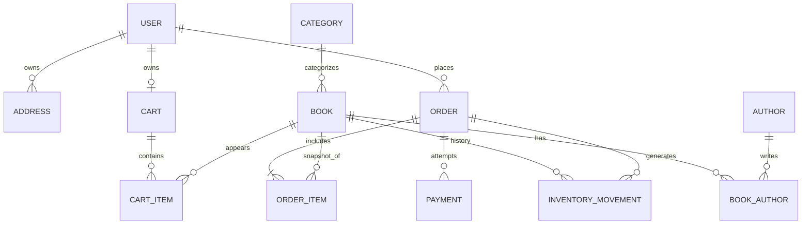

# Database Design — PostgreSQL + Prisma (v1.0)

`prisma/schema.prisma` là model source-of-truth. Dưới đây là mục đích/ràng buộc nghiệp vụ; một số check constraint nâng cao cần SQL migration bổ sung trước production.

## ERD (logic)

## Entities
| Entity | Key fields | Notes |
|---|---|---|
| User | id UUID, email unique, passwordHash, role | không trả passwordHash |
| Address | id, userId, recipientName, phone, line1, city, district, ward | ownable; order copy snapshot |
| Category | id, name, slug unique, description?, isActive, sortOrder | Public storefront only exposes active records; sorted by `sortOrder`, then name; inactive records are retained for admin management |
| Author | id, name | ISBN not author identifier |
| Book | id, sku unique, isbn nullable unique, slug unique, title, priceVnd, salePriceVnd, stock, status | soft archive, price integer |
| BookImage | id, bookId, imageUrl, sortOrder | optional ordered gallery; removed with its book only |
| Banner | id, title, altText, imageUrl, href, objectPosition, isActive, sortOrder | active records feed homepage carousel |
| BookAuthor | (bookId,authorId) composite PK | N:N |
| Cart | id, userId unique | một cart/user |
| CartItem | (cartId,bookId) unique, quantity | server validates |
| Order | id, orderCode unique, userId, status, paymentMethod, subtotalVnd, shippingFeeVnd, totalVnd, addressSnapshot JSON, idempotencyKey | immutable totals after placed |
| OrderItem | id, orderId, bookId, sku/title snapshots, unitPriceVnd, quantity, lineTotalVnd | historical snapshots |
| OrderStatusEvent | orderId, actorId?, fromStatus, toStatus, reason?, createdAt | audit trail for admin status operations |
| Payment | id, orderId, method, status, providerTxnId nullable unique | not card data |
| InventoryMovement | id, bookId, orderId?, delta, reason, sourceKey unique | positive/negative movements |

## Constraints + indexes
- `email` normalized lowercase; unique CI cần quy tắc application hoặc `citext` + migration (schema Prisma `@unique` thôi chưa bảo đảm case-insensitive).
- Các amount VND `Int` >= 0; khi có giá bán giảm, `salePriceVnd <= priceVnd`. Validation service và SQL CHECK nên đồng thời.
- `book.stock >= 0`, `cartItem.quantity > 0`, `orderItem.quantity > 0`; dùng DB CHECK trong migration.
- Index `Book(status,createdAt)`, `Book(categoryId,status)`, `Order(userId,createdAt)`, `Order(status,createdAt)`, `InventoryMovement(bookId,createdAt)`.
- `Order` has a composite unique key `(userId, idempotencyKey)` (UUID từ client) + `requestHash`; therefore one customer can retry safely while the same literal key of another customer does not collide.
- `Category(isActive, sortOrder, name)` is indexed for the public navigation read path. `isActive` and `sortOrder` are non-destructive defaults (`true`/`0`) so existing category records remain available after the schema update.
- `Banner(isActive, sortOrder)` is indexed for the public carousel read path. The banner and book-image additions are additive; existing books/categories/orders remain valid.
- `InventoryMovement.sourceKey` unique để ngăn double restore; định dạng `order:<id>:create` / `order:<id>:cancel`.

## Pricing example
Sách A giá 120000 VND, quantity 2, ship 30000 ⇒ `subtotalVnd=240000`, `totalVnd=270000`. Snapshot `unitPriceVnd=120000` tại lúc order, dù sau đó book price tăng.

## Stock handling
Trong transaction checkout: kiểm book Published + tồn >= qty, decrement điều kiện `stock >= qty`, tạo order/items/movement, clear cart. Nếu bất kỳ bước nào thất bại => rollback.

Cancel PENDING: transaction `updateMany(order where status=PENDING)` conditional, nếu đúng 1 record thì restore theo orderItems + movement unique; nếu đã cancelled không restore nữa.

## Migration notes

The checkout phase changes the old global `Order.idempotencyKey` uniqueness into a composite `(userId, idempotencyKey)` uniqueness. Dev Compose runs `prisma db push`, which applies this non-destructive index change to the local database. Before production, generate and review a committed migration; do not use `db push` in production.

## Migrations
**Dev starter:** `npx prisma db push` để khởi tạo dễ dàng. **Trước production:** commit SQL migrations (`npx prisma migrate dev --name ...`) + bổ sung CHECK/index/CITEXT nếu cần; dùng `migrate deploy`, không dùng `db push`.

## Retention/privacy
Không xóa lịch sử mua hàng đã có giao dịch khi xóa/ẩn book; lưu minimal PII; hạn chế export customer details; định nghĩa retention theo luật/khách hàng trước production.
