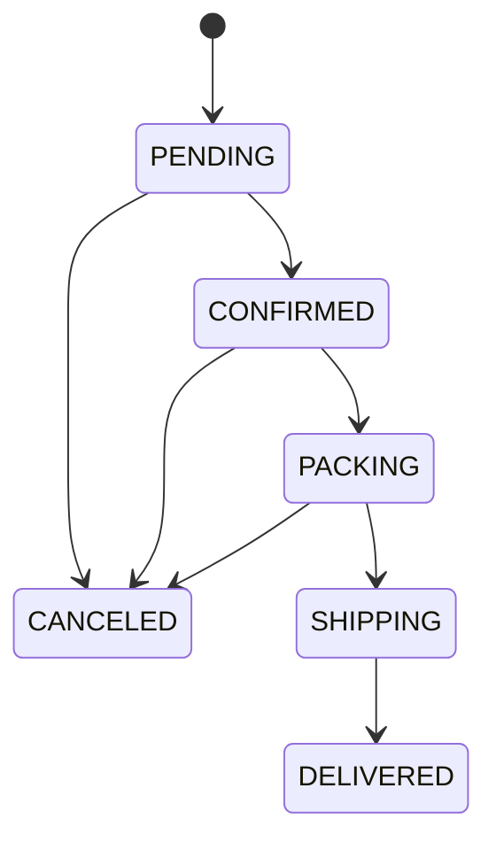

# Business Workflows & State Machines

## 1. Checkout (COD MVP)
```mermaid
sequenceDiagram
  participant C as Customer UI
  participant O as Orders API
  participant DB as PostgreSQL
  C->>O: POST /orders + Idempotency-Key
  O->>DB: Begin transaction; idempotency check
  O->>DB: Load cart, validate books/address
  O->>DB: Atomic stock decrement for each book
  O->>DB: Create order/items snapshots + stock movements
  O->>DB: Delete cart items; Commit
  O-->>C: 201 order summary
```

### Failure behavior
- Bad address, empty cart, out-of-stock, stale catalog => 4xx; transaction rollback; cart unchanged.
- DB unavailable => 503/500; can safely retry same idempotency key.
- Duplicate idempotency key same payload => return prior order; different payload => 409.
- Atomic decrement guarded by `stock >= requested`, not `read then write` separately.

## 2. Order state machine


MVP rules: Customer can cancel **PENDING only**; Admin can cancel PENDING/CONFIRMED/PACKING (provided not shipped); SHIPPING and DELIVERED cannot cancel via MVP. On any valid cancellation restock exactly once.

## 3. Inventory semantics
- One stock field `Book.stock` is number of currently sellable copies.
- COD placement decreases stock immediately (simple model), cancellation restores.
- Admin restock/adjustment requires note + sourceKey + audit movement.
- Delivery does not decrease stock a second time.
- `sourceKey` prevents duplicate inventory effects even if request retries. Implemented line-level keys are `order:<orderId>:create:<bookId>` and `order:<orderId>:cancel:<bookId>`.

## 4. Future online payment
- Do not activate until provider contract decided.
- For paid online flow: pending payment expiry & reserved stock TTL must be modeled; only confirm after verified callback/IPN (signature, amount, order id, replay protection), not browser redirect.
- Refunds, returns and shipping carrier tracking are separate phases.

## 5. Administrative governance
- Every order status transition stores actor/time/reason in audit trail (event table to be added before full implementation if audited status history is required).
- Never edit paid/placed order item snapshots retroactively.
- Sales reporting MVP counts Delivered only, not PENDING/CONFIRMED.
